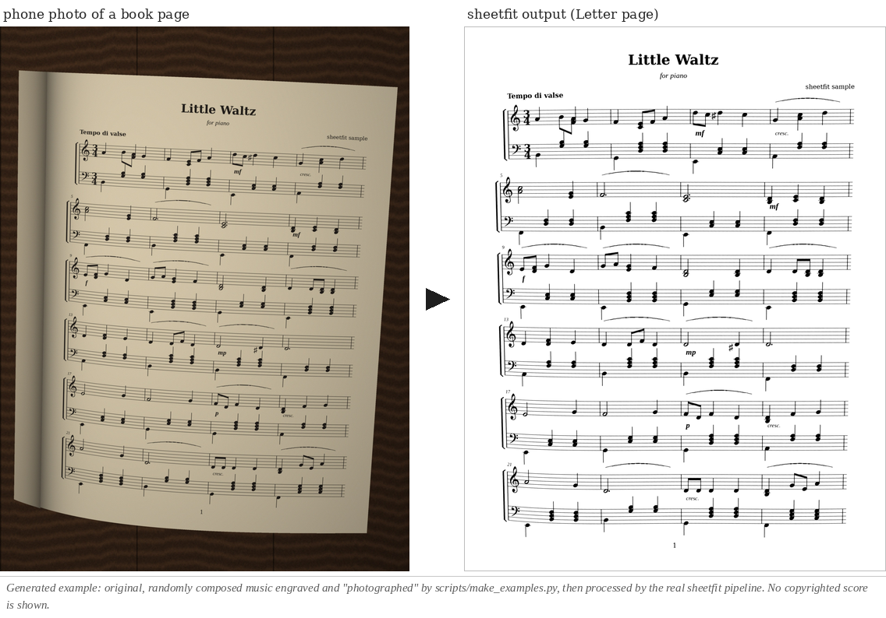
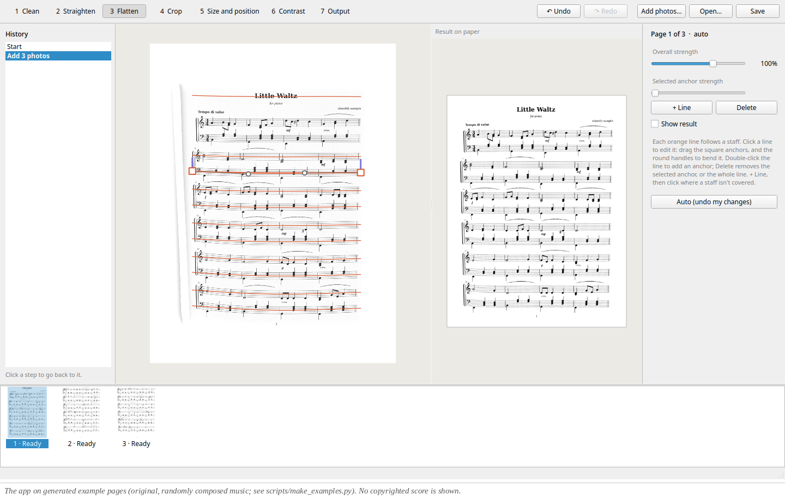

# sheetfit

[](https://github.com/michaelyshung/sheetfit/actions/workflows/tests.yml)

Turn phone photos of sheet music into clean, straight, print-ready pages.



*Real example: a phone photo of a page from a bound book, and the output.*

`sheetfit` takes photos or scans of sheet music (including pages photographed
straight out of a bound book) and produces a multi-page PDF where every page is:

- **straightened**: tilt is detected from the staff lines
- **dewarped**: staves that curve towards the book's spine are flattened
- **cleaned**: shadows, lighting gradients, tinted paper, highlighter,
  coloured banners, page edges, neighbouring pages and the table are removed
- **high contrast**: background to pure white, faded/grey notation to black,
  so it prints crisply on a monochrome printer
- **consistent**: staff lines print at the same size on every page, even if
  the photos were taken from different distances
- **fitted** to Letter, A4 or Legal with consistent margins

Page numbers are kept, iPhone HEIC photos work directly, and pages without
music (a cover, a photo) are kept as plain photos instead of being mangled.

It is a single command, works on a whole folder at once, and only depends on
`numpy`, `Pillow` and `pillow-heif` (for iPhone photos).

## The app



`sheetfit-app` opens a window with one editor per step. Every page starts
with the automatic result; change only what needs it:

1. **Clean**: keep or drop coloured markings, lighting and edge cleanup
2. **Straighten**: angle slider, 90° turns, or drag a guide onto any staff line
3. **Flatten**: an orange Bezier curve follows each staff. Click one to edit
   it: drag anchors and handles, double-click to add an anchor, set how hard
   each anchor is pulled flat, add or delete lines
4. **Crop**: drag the corners
5. **Size and position**: drag and resize the music on the paper, with a ghost
   of the pages you pick behind it to keep everything lined up
6. **Contrast**: clean background, darken lines, black and white
7. **Output**: paper, margins, then save a PDF or print

Every editor shows the finished page on paper beside it, and has an **Auto**
button to redo that step automatically. All sliders apply as you drag.

The **History** panel on the left lists every change, like Photoshop's:
click any step to go back to it (or forward again). Undo and redo are also
on Ctrl+Z and Ctrl+Shift+Z / Ctrl+Y.
Projects save as `.sheetfit` files, which the command line can also render.

## Install

```bash
pip install git+https://github.com/michaelyshung/sheetfit            # command line only
pip install "sheetfit[gui] @ git+https://github.com/michaelyshung/sheetfit"   # plus the app
```

The command-line version stays lightweight (numpy, Pillow, pillow-heif) and
runs on Python 3.10+; the app adds PySide6 and needs Python 3.12+. On Linux the app also needs one system library that
Qt doesn't bundle:

```bash
sudo apt install libxcb-cursor0
```

Or, from a clone:

```bash
pip install .
```

## Use

```bash
# a folder of photos (processed in file-name order) -> one PDF
sheetfit "photos/waltz/" -o waltz.pdf

# specific files, A4, pure black & white, also save PNG pages
sheetfit p1.jpg p2.jpg p3.jpg -o out.pdf --paper a4 --bw --png-dir pages/
```

Without installing: `python -m sheetfit ...` from the `src/` directory.

### Options

| Option | Default | What it does |
|---|---|---|
| `-o, --output FILE` | `sheets.pdf` | Combined PDF |
| `--png-dir DIR` | | Also write one PNG per page |
| `--paper letter\|a4\|legal` | `letter` | Page size |
| `--dpi N` | `300` | Output resolution |
| `--margin IN` | `0.4` | Page margin in inches |
| `--orientation portrait\|landscape\|auto` | `portrait` | `auto` picks landscape for wide content |
| `--align top\|center` | `top` | Vertical placement on the page |
| `--no-uniform-scale` | | Fill each page instead of matching staff size across pages |
| `--non-music photo\|skip\|music` | `photo` | Pages without staff lines: keep as a plain photo, leave out, or clean like music |
| `--bw` | off | Pure 1-bit black & white (smallest, sharpest on laser printers) |
| `--bw-threshold N` | `170` | Cut-off for `--bw` |
| `--white-point N` | `215` | Grey level at/above which becomes white. Lower = cleaner background |
| `--darken G` | `1.8` | Gamma pushing greys toward black. Higher = bolder lines, `1` = off |
| `--keep-color-marks` | off | Keep coloured pencil/pen annotations (as grey) instead of dropping colours |
| `--rotate DEG` | `0` | Pre-rotate clockwise, e.g. `90` for sideways photos without EXIF |
| `--max-angle DEG` | `10` | Largest tilt to search for |
| `--no-flatten`, `--no-deskew`, `--no-crop`, `--no-dewarp` | | Skip a step |

## How it works

1. **Gray by brightest channel.** Black ink is dark in every RGB channel;
   tinted paper, highlighter and coloured boxes are bright in at least one.
   Taking the per-pixel maximum keeps the notation and drops the colours.
2. **Flatten lighting.** Estimate the paper brightness everywhere (max filter
   to erase ink, then blur) and divide it out, removing shadows and gradients.
3. **Remove what isn't paper.** In the outer margins, columns/rows whose
   *median* is dark or mid-grey can't contain music (music is mostly white
   between staff lines), so page-edge shadows, the next page and the table are
   blanked, along with thick dark blobs touching the border (curled corners).
4. **Deskew.** Try rotation angles (coarse to fine, to 0.02°) and keep the one
   where the horizontal ink profile is sharpest, i.e. staff lines are level.
5. **Crop** to the largest block of ink, merging systems separated by gaps.
6. **Dewarp.** Cut the page into vertical strips and horizontal bands. Walking
   outward from the middle strip, cross-correlate each strip's staff-line
   profile with its neighbour's to measure how far the lines drift up or down.
   Fit a smooth surface `d(x, y)` (4th order across, quadratic down, so the top
   and bottom can bend differently) and shift every pixel column by it. Safety
   checks skip the step if there's too little music or the fit is poor.
7. **Contrast for printing.** Levels (darkest ink → black, `--white-point` →
   white) plus a gamma curve that pulls faded lines to black.
8. **Same size everywhere.** Measure the staff-line spacing on every page
   (autocorrelation of the row profile; no clear period = not music). Pick
   the largest printed staff size at which every page still fits, and scale
   each page to it.
9. **Fit** to the page within the margins and write the PDF/PNGs.

## Tips and limitations

- Photograph pages **flat-on and well lit**. Moderate tilt, shadows and book
  curl are handled; strong perspective (shooting at a steep angle) is not yet
  corrected.
- Dewarping corrects vertical bending only. Very close to the spine the music
  is also compressed sideways, and that isn't undone.
- Low-resolution photos are upscaled to fill the page. Notation stays legible,
  but small text gets soft. Use your camera's full resolution.
- Matching staff size means a page with less music gets more white space
  rather than being blown up. Use `--no-uniform-scale` to fill every page.

## Projects: save, tweak, re-render

Every automatic decision (rotation, straighten angle, flatten guide lines,
crop, staff size) is recorded per page in a *recipe*. Save them as a project,
adjust anything, and render it again:

```bash
sheetfit photos/ --save-project waltz.sheetfit   # automatic recipes
# ...edit waltz.sheetfit (JSON), or open it in the sheetfit app...
sheetfit --project waltz.sheetfit -o waltz.pdf    # render exactly that
```

Page-curl flattening works along *guide lines*: one per staff, tracing where
it really sits on the curled page, with a strength at each point. The
automatic step draws the guides; editing them changes how the page is
flattened.

## Development

```bash
python -m unittest discover tests      # or: pytest
```

Tests build synthetic sheet-music photos (tilted, curled, on a table, with
coloured paper) and check every step plus the CLI end to end.

## Personal use

sheetfit is meant for making clean, printable copies of music **you already
own or have the right to use**, for your own practice and performance. It
is not a tool for copying or sharing other people's work. Most published
sheet music, including editions of public-domain pieces, is protected by
copyright; scanning and sharing it, publicly or with others, may infringe
those rights. You are responsible for how you use this tool and its output.

## License

MIT (see [LICENSE](LICENSE)): the software comes with no warranty.
